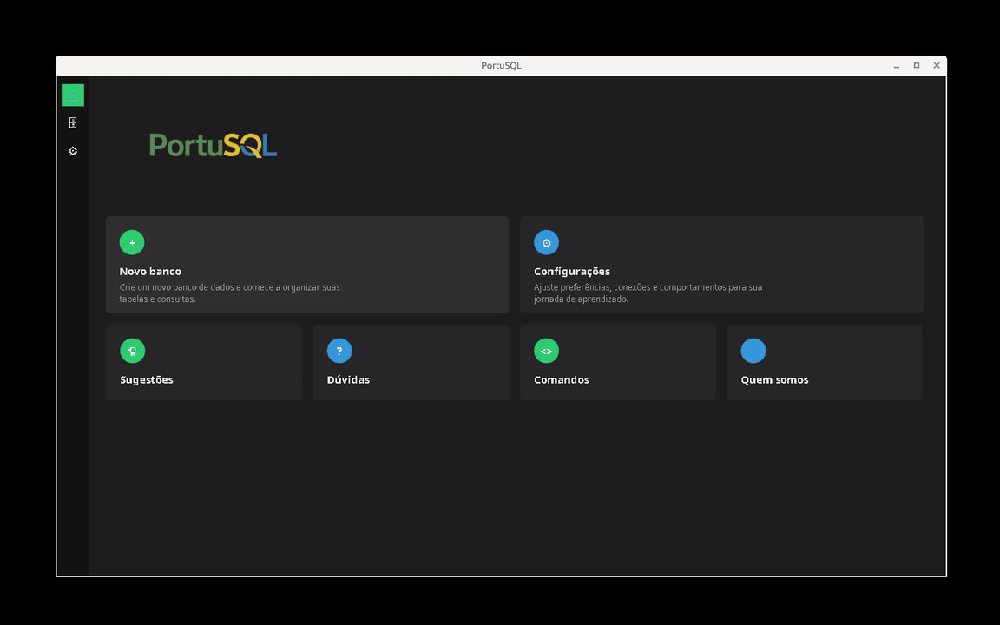
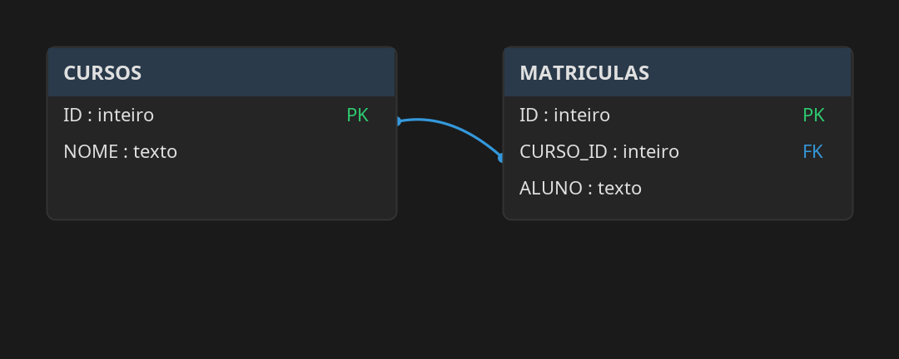

<div align="center">

# PortuSQL

SQL em português para o ensino de bancos de dados.

[](https://github.com/00salociN/PortuSQL/releases)
[](https://adoptium.net/)
[](https://www.h2database.com/)
[](LICENSE)

</div>

## Apresentação

PortuSQL é um dialeto de SQL escrito em português, com uma interface gráfica própria. A proposta é permitir que o estudante trabalhe primeiro com a lógica das operações em um banco de dados. Para isso, os comandos mais comuns do SQL foram adaptados para o português.

```text
SELECIONAR nome, idade DE alunos ONDE idade > 18
```

O comando é traduzido para SQL do H2, executado em um banco embarcado e mostrado na interface com seu resultado. O projeto tem lexer, parser, tradutor e executor próprios; a sintaxe em português é só a parte visível.

## Demonstração

O fluxo completo em poucos segundos: criar um banco, chegar ao editor, executar comandos e ver o resultado.



O painel de DER lê os metadados do banco em uso e mostra tabelas, colunas, chaves e relacionamentos.



## Características

| Área | O que o projeto oferece |
|---|---|
| Linguagem | comandos próprios para definição, manipulação e consulta de dados |
| Interpretador | lexer, parser, tradutor e executor escritos no projeto |
| Banco | H2 embarcado, com arquivos de banco mantidos pelo próprio PortuSQL |
| Interface | editor com realce de sintaxe, navegador de bancos, painel de resultados e DER |
| Acompanhamento de versões | verificação de novas versões e abertura das notas no navegador |

A linguagem e a interface podem evoluir de forma independente. Os detalhes do que muda em cada versão ficam no [histórico de alterações](CHANGELOG.md).

## Como funciona

O interpretador percorre etapas simples. Cada uma entrega algo para a próxima:

```text
Comando escrito pelo usuário
          |
          v
        Lexer
          |
          v
        Parser
          |
          v
       Tradutor
          |
          v
       Executor
          |
          v
     Banco H2
          |
          v
       Resultado
```

A interface chama o mesmo caminho de execução usado pelo projeto como um todo. A árvore de comandos não conhece SQL, e o tradutor é o único ponto que decide o que o H2 recebe. A explicação completa das etapas, dos erros e dos metadados do DER está em [`docs/arquitetura.md`](docs/arquitetura.md).

## Início rápido

1. Baixe o executável na [página de releases](https://github.com/00salociN/PortuSQL/releases).
2. Execute com Java 17 ou superior:

   ```bash
   java -jar PortuSQL.jar
   ```

3. Crie um banco pelo card **Novo banco** da homepage.
4. No editor, execute um comando por vez:

   ```text
   CRIAR TABELA alunos (id inteiro CHAVE PRIMARIA, nome texto NAO NULO, idade inteiro)
   ```

   ```text
   INSERIR (id, nome, idade) EM alunos VALORES (1, 'Ana', 20)
   ```

   ```text
   SELECIONAR nome, idade DE alunos
   ```

O resultado aparece na aba **Resultados**. Os nomes dos arquivos publicados, o instalador do Windows e o script do Linux estão em [`docs/instalacao.md`](docs/instalacao.md).

## Documentação

| Documento | Para que serve |
|---|---|
| [`COMANDOS.md`](COMANDOS.md) | referência da linguagem e comandos aceitos |
| [`ESPECIFICACAO.md`](ESPECIFICACAO.md) | gramática, semântica e regras da linguagem |
| [`docs/arquitetura.md`](docs/arquitetura.md) | funcionamento do interpretador, erros, H2 e DER |
| [`docs/instalacao.md`](docs/instalacao.md) | artefatos, instalação e compatibilidade |
| [`LIMITACOES.md`](LIMITACOES.md) | recursos ausentes, parciais ou indisponíveis hoje |
| [`ROADMAP.md`](ROADMAP.md) | funcionalidades planejadas |
| [`CHANGELOG.md`](CHANGELOG.md) | histórico de alterações por versão |
| [`CONTRIBUTING.md`](CONTRIBUTING.md) | ambiente, build e verificações antes de contribuir |
| [`docs/glossario.md`](docs/glossario.md) | termos usados na documentação técnica |
| [Notas das releases](https://github.com/00salociN/PortuSQL/releases) | descrição pública de cada lançamento |

## Desenvolvimento

O projeto usa Java 17, Maven Wrapper e H2 embarcado. Para compilar e gerar o executável:

```bash
./mvnw clean package
# execute o .jar gerado em target/
```

O passo a passo completo, incluindo verificações antes de um pull request, está em [`CONTRIBUTING.md`](CONTRIBUTING.md).

## Contribuição

Ideias, correções e material de aula são bem-vindos. Abra uma [issue](https://github.com/00salociN/PortuSQL/issues) para alinhar o escopo antes do pull request. Dúvidas podem ir para as [Discussões](https://github.com/00salociN/PortuSQL/discussions).

## Licença

MIT — veja [LICENSE](LICENSE).

Desenvolvido por Nicolas Gabriel Venâncio dos Santos como projeto de ensino de bancos de dados.
